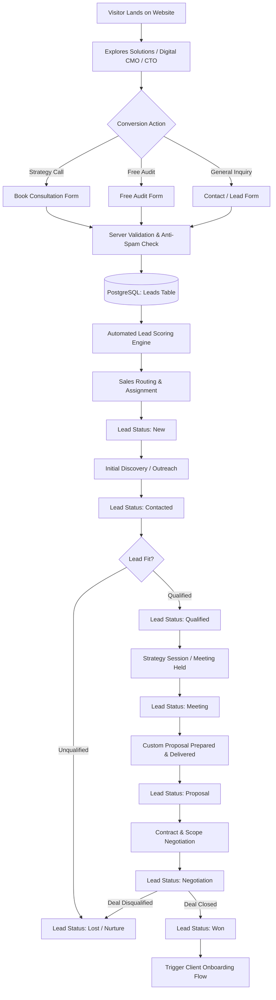

# Product Discovery & Strategic Brief: DiziBrand Media

## 1. Executive Summary & Brand Identity

- **Brand Name**: DiziBrand Media
- **Brand Line**: Marketing. Technology. AI. Data. Leadership.
- **Core Promise**: *Your Business Deserves More Than an Agency. Build Your Growth & Technology Team With Us.*
- **Supporting Tagline**: *Build. Market. Automate. Scale.*
- **Executive Positioning**: A premium global Growth, Marketing, Technology, AI, Data, and Leadership partner. DiziBrand Media is not an outsourced vendor or a conventional digital marketing agency—it is an on-demand, integrated strategic growth and technology team embedded within ambitious enterprises, scale-ups, and startups.

---

## 2. Problem Space & Market Opportunity

Modern businesses face critical friction when scaling:
1. **The "Agency Fragmentation" Trap**: Companies hire one agency for SEO, another for performance ads, a dev shop for software/web, and consultants for analytics. The result is misaligned KPIs, finger-pointing, and bloated management overhead.
2. **Lack of Strategic Executive Leadership**: Startups and SMEs need elite CMO and CTO leadership to navigate AI transformation, data architecture, and market expansion, but hiring full-time C-suite executives is often cost-prohibitive or premature.
3. **Execution-Strategy Disconnect**: Traditional management consultancies offer PowerPoint presentations without hands-on technical execution. Traditional digital marketing agencies execute basic tactical campaigns without understanding core software engineering, data pipelines, or unit economics.

**The DiziBrand Solution**:
An integrated ecosystem that unifies **Fractional Executive Leadership (Digital CMO & Digital CTO)** with deep technical engineering (Web, App, SaaS, CRM/ERP), AI automation & agents, performance marketing, and business intelligence—under one roof, powered by unified operational transparency.

---

## 3. Target Audiences & Decision Makers

DiziBrand Media serves high-intent B2B and consumer decision-makers:
- **Founders & Co-Founders**: Early-stage to Series B venture-backed startups needing rapid go-to-market and scalable tech infrastructure.
- **CXOs (CEOs, CMOs, CTOs, COOs, CDOs)**: Established enterprises and mid-market organizations pursuing digital modernization, AI agent deployment, and performance scaling.
- **SMEs & Scale-ups**: Growing companies requiring institutional-grade marketing and engineering without building large internal teams.
- **Verticals**:
  - SaaS & B2B Technology
  - E-commerce & D2C Brands
  - Real Estate & PropTech
  - Healthcare & HealthTech
  - Education & EdTech
  - Banking, Financial Services & Insurance (BFSI) / FinTech
  - Manufacturing, Supply Chain & Logistics
  - Cross-border & International Enterprises

---

## 4. Core Value Propositions & Offerings

### A. Leadership On-Demand
- **Digital CMO**: Strategic brand positioning, omnichannel acquisition engines, CAC-to-LTV optimization, marketing ops, and board-level reporting.
- **Digital CTO**: Technical architecture, cloud infrastructure, AI adoption roadmaps, engineering team governance, and security compliance.

### B. Full-Spectrum Technology & AI
- Custom Software, SaaS platforms, High-performance Web & Mobile Applications.
- AI Automation & Autonomous AI Agents.
- Enterprise CRM/ERP implementations and data pipeline engineering.

### C. Full-Funnel Marketing & Growth
- Performance Marketing (Meta, Google, LinkedIn, programmatic).
- High-intent B2B Lead Generation & ABM.
- Technical & International SEO.
- Brand identity systems and conversion rate optimization (CRO).

### D. Data & Business Intelligence
- Multi-touch attribution modeling, revenue forecasting, predictive customer modeling, and executive BI dashboards.

---

## 5. Core Platform & Portal Ecosystem

The platform operates on a single unified backend, single PostgreSQL database, and strict RBAC across **exactly three portals**:

```
                               ┌─────────────────────────┐
                               │   DiziBrand Platform    │
                               │   (Next.js + Postgres)  │
                               └────────────┬────────────┘
                 ┌──────────────────────────┼──────────────────────────┐
                 ▼                          ▼                          ▼
     ┌───────────────────────┐  ┌───────────────────────┐  ┌───────────────────────┐
     │ Super Admin / Mgmt    │  │     Team Portal       │  │    Client Portal      │
     │ - CRM & Pipeline      │  │ - Sales               │  │ - Org-scoped Projects │
     │ - CMS & Content       │  │ - Project Managers    │  │ - Milestones & Tasks  │
     │ - Team & Freelancers  │  │ - Specialists / Devs  │  │ - Invoices & Contracts│
     │ - RBAC & Audit Logs   │  │ - Freelancers (Tasks) │  │ - Deliverables Review │
     └───────────────────────┘  └───────────────────────┘  └───────────────────────┘
```

---

## 6. End-to-End Lead Journey

The lead acquisition and conversion lifecycle is fully instrumented from initial discovery to deal close:



---

## 7. Phase 1 Framing: Goals, Assumptions, Risks, and Acceptance Criteria

### Goals
1. Establish complete architectural, technical, operational, and UX foundations.
2. Eliminate ambiguity across all data models, access controls, user personas, and workflows before code implementation.
3. Deliver full documentation and specifications strictly aligned with the corporate-tech positioning.

### Assumptions
- A single normalized PostgreSQL database suffices for all portals, CRM, CMS, and transactional workflows.
- Content changes will be managed via a headless CMS (Sanity.io or Prisma-backed internal CMS).
- All prospective client interactions can be represented through configurable adapters (Calendar, Email, WhatsApp, Payments).

### Risks & Mitigations
- **Risk**: Role escalation or cross-tenant data leakage between clients.
  - *Mitigation*: Multi-tenant organization isolation enforced at the database query layer (server-side), never reliant on UI filters.
- **Risk**: High bounce rate on lead forms.
  - *Mitigation*: Progressive disclosure forms with country/currency sensitivity (USD/INR), budget brackets, and real-time field validation.
- **Risk**: Hallucinated metrics or fake social proof damaging credibility.
  - *Mitigation*: Strict zero-fake-proof policy: all client logos, metrics, and case studies utilize neutral "Pending Verification" placeholders until genuine verified data is supplied.

### Acceptance Criteria
- All 15 specification documents are created in `/docs`.
- All 5 required Mermaid diagrams are valid, complete, and rendered correctly.
- Database schema covers 30+ normalized entities with clear foreign keys and indexes.
- RBAC matrix covers all 7 distinct roles across all 3 portals without overlap.
