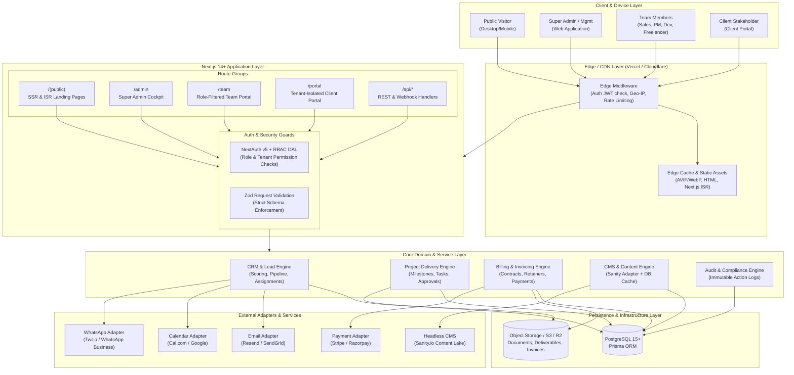

# System Architecture Specification: DiziBrand Media

This document defines the high-level system architecture, service boundaries, data flow, security tiers, and deployment topology of the DiziBrand Media platform.

---

## 1. High-Level System Architecture Diagram



---

## 2. Architectural Boundaries & Modularity

### A. Shared Business Logic & Domain Layer
The platform avoids duplicating logic between portals. Domain logic resides in pure TypeScript modules under `src/lib/domain/`:
- `crm/`: Lead scoring calculations, status progression rules, sales assignment algorithms.
- `projects/`: Milestone state transitions, deliverable sign-off workflows, task dependencies.
- `billing/`: Invoice generation, tax calculations (GST/VAT/Sales Tax), payment status reconciliations.
- `audit/`: Standardized logging helper capturing `userId`, `action`, `entityType`, `entityId`, `ipAddress`, and `metadata`.

### B. Portal Boundaries & Route Groups
Using Next.js App Router route groups, each portal has dedicated layouts, navigations, and access controls while sharing reusable primitives:
1. `app/(public)/`: Public marketing site. Optimized for SEO, Core Web Vitals, and conversion rate. Static/ISR rendering where possible.
2. `app/admin/`: Super Admin & Management. Protected by `role IN ['SUPER_ADMIN', 'MANAGEMENT']`. Dense, data-heavy dashboards, data tables, CRM pipelines.
3. `app/team/`: Unified Team Portal. Protected by `role IN ['SALES', 'PROJECT_MANAGER', 'EMPLOYEE', 'FREELANCER']`. Dynamically renders views according to active user role.
4. `app/portal/`: Client Portal. Protected by `role === 'CLIENT'`. Strictly scopes all queries to `session.user.companyId`.

---

## 3. Data Access Layer (DAL) & Multi-Tenant Isolation

To prevent unauthorized cross-tenant data access, the application uses a strict Data Access Layer pattern:

```typescript
// Example DAL pattern for Client Portal
export async function getClientProjects(session: Session) {
  if (!session?.user || session.user.role !== 'CLIENT') {
    throw new UnauthorizedError('Access restricted to authenticated clients');
  }
  
  if (!session.user.companyId) {
    throw new ForbiddenError('Client account is not linked to an organization');
  }

  // Automatic tenant scoping
  return prisma.project.findMany({
    where: {
      companyId: session.user.companyId,
      status: { not: 'ARCHIVED' }
    },
    include: {
      milestones: {
        orderBy: { order: 'asc' }
      },
      deliverables: true
    }
  });
}
```

---

## 4. Caching & Performance Strategy

1. **Incremental Static Regeneration (ISR)**:
   - Public service pages, industry guides, and insights are pre-rendered at build time with ISR (`revalidate = 3600`).
   - On CMS publication via Sanity or admin panel, an API webhook triggers `revalidateTag('services')` or `revalidatePath('/work/[slug]')` for on-demand edge cache invalidation.
2. **Dynamic Portal Rendering**:
   - Portals (`/admin`, `/team`, `/portal`) are dynamically rendered with `export const dynamic = 'force-dynamic'` and `cache: 'no-store'` on transactional queries to ensure real-time consistency.
3. **Asset Optimization**:
   - Next.js `<Image>` component automatically optimizes images to WebP/AVIF format with explicit aspect ratios to guarantee Cumulative Layout Shift (CLS) < 0.1.

---

## 5. Security & Defense-in-Depth

- **Authentication**: Cryptographically signed HTTP-only cookies (`__Secure-next-auth.session-token`).
- **Authorization**: Two-tier check: Edge middleware (fast route rejection) + Server-side DAL (data-level constraint).
- **Validation**: All incoming mutation payloads validated with Zod schemas; unknown fields are stripped.
- **CSRF & Anti-Spam**: Next.js Server Actions and Route Handlers validate origin headers and anti-spam tokens (honeypot fields + reCAPTCHA/Turnstile verification adapter).
- **Audit Trails**: All sensitive write operations (lead status updates, invoice mark-as-paid, user role edits) write an immutable record to the `AuditLogs` table.
