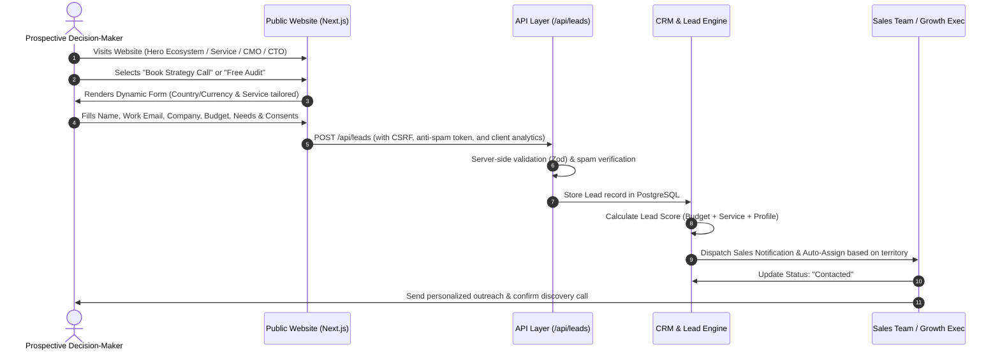
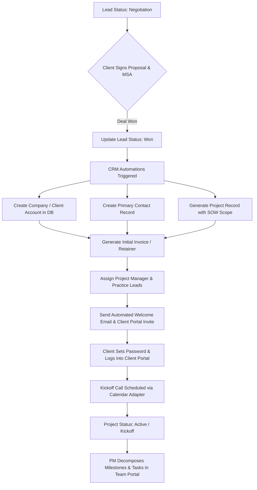
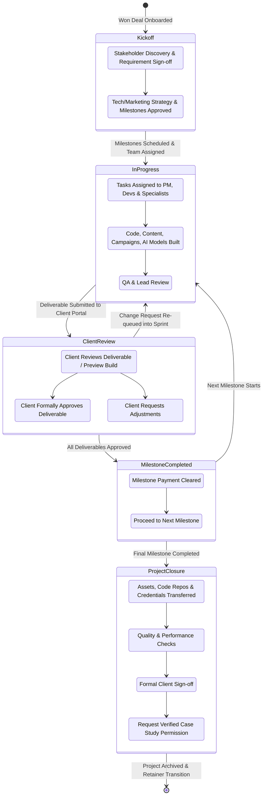

# User Journeys & Delivery Lifecycles: DiziBrand Media

This document outlines the end-to-end user journeys, operational state transitions, and system automation workflows.

---

## 1. Prospect-to-Lead Conversion Journey

### Lead Scoring Engine Logic
The lead scoring algorithm computes an integer score (0–100) based on weighted parameters:
- **Budget Fit (35%)**:
  - $25,000+ or INR 20L+ = 35 pts
  - $10,000–$25,000 or INR 8L–20L = 28 pts
  - $5,000–$10,000 or INR 4L–8L = 20 pts
  - $2,500–$5,000 or INR 2L–4L = 12 pts
  - Under $2,500 = 5 pts
  - Not Sure = 8 pts
- **Service Alignment (25%)**:
  - Digital CMO / Digital CTO / Dedicated Team = 25 pts
  - Software / App / SaaS / AI Automation = 22 pts
  - Performance Marketing / CRM / Data Analytics = 18 pts
  - SEO / Branding / Other = 12 pts
- **Company Profile & Work Email (20%)**:
  - Verified Business Domain (non-free email like gmail/yahoo) = 15 pts
  - Complete Company Name + Valid Website URL = 5 pts
- **Geography & Intent (10%)**:
  - Priority target markets (US, UK, EU, UAE, Tier-1 India) = 10 pts
- **Form Completeness & Project Description (10%)**:
  - Detailed project description (>50 words) = 10 pts
  - Brief description (<50 words) = 5 pts

*Note: High score leads trigger urgent Slack/Email alerts. Leads are never rejected solely on an automated score.*

---

## 2. Won-Deal-to-Client-Project Onboarding Flow

### Key Milestone Transitions
1. **Commercial Finalization**: Deal marked `WON` triggers automated entity creation in PostgreSQL:
   - `Leads.status` updated to `WON`.
   - `Companies` record verified or created.
   - `Contacts` converted into `Users` with `CLIENT` role.
   - `Projects` entity initialized with reference to proposal.
2. **Client Portal Provisioning**:
   - Invitation link sent with secure cryptographic token (expiring in 72h).
   - Client accesses `/portal/setup` to configure credentials.
   - Tenant isolation tag (`companyId`) assigned to client user session.

---

## 3. Project Delivery Lifecycle Flow

---

## 4. Client Support & Change Request Workflow

Clients can raise tickets or change requests directly from `/portal/support`:
1. **Submission**: Client specifies ticket title, category (Bug, Change Request, Question, Asset Request), priority (Low, Normal, Urgent), and attachments.
2. **Triage**: Project Manager is notified immediately via email/portal notification.
3. **Classification**:
   - If **In-Scope / Bug**: Assigned to appropriate specialist in Team Portal; tracked against current milestone.
   - If **Out-of-Scope / Change Request**: PM prepares an addendum/estimate; once approved by Client via Portal, an additional milestone or task is generated.
4. **Resolution & Sign-off**: Specialist submits fix; PM validates; Client receives notification to verify and close the ticket.

---

## 5. Freelancer Engagement Lifecycle

1. **Intake (`/freelancers`)**: External specialist submits portfolio, skill tags, hourly/day rate, timezone, and NDA consent.
2. **Review (`/admin/team/freelancers`)**: Management reviews credentials, initiates vetting or technical screening.
3. **Onboarding**: Upon passing screening, user account is created with `FREELANCER` role.
4. **Task Assignment**: PM assigns specific, bounded tasks in Team Portal.
5. **Execution**: Freelancer submits deliverables via `/team/freelancer/tasks/[id]`.
6. **Payment Approval**: PM approves deliverable → Status moves to `Approved for Payment` → Admin releases disbursement → Freelancer views updated payment status in their dashboard.
